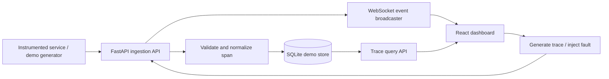

# TraceForge realtime architecture

## Data flow
1. A demo request or external service submits a span.
2. FastAPI validates the payload and writes the span to SQLite.
3. The API emits a WebSocket event to connected dashboards.
4. React updates the selected trace and inspector immediately.
5. The dashboard derives the service status and evidence from received spans.

## Production next steps
- Add an OpenTelemetry Collector with OTLP HTTP/gRPC ingestion.
- Validate W3C/OpenTelemetry trace and span identifiers.
- Add auth, tenant-scoped queries, redaction, rate limits, retention, and migrations.
- Move from SQLite to PostgreSQL/ClickHouse or a mature tracing backend at scale.
- Build an evaluation corpus and measure diagnosis precision/recall before describing insights as reliable.
